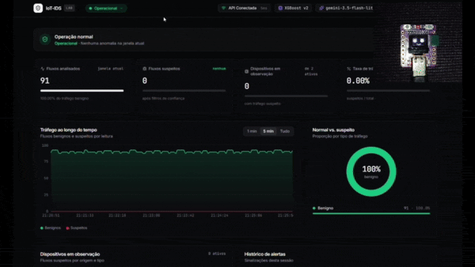
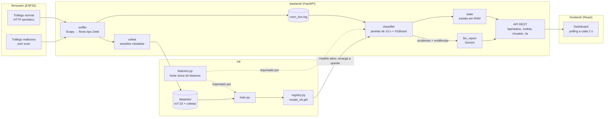
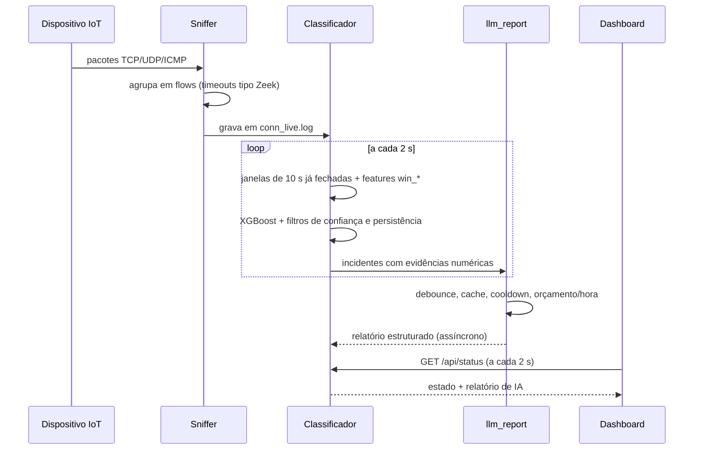

# CyberSentinel-IoT

Sistema de detecção de intrusão para redes IoT, feito para rodar localmente, com hardware barato e sem depender de appliances caros ou de serviços em nuvem para classificar tráfego.

O CyberSentinel-IoT captura os pacotes da rede dos dispositivos, transforma cada conexão no mesmo formato do `conn.log` do Zeek, classifica o comportamento de cada dispositivo com um modelo de machine learning (XGBoost) e mostra tudo num dashboard em tempo real. Quando um incidente se estabiliza, uma IA generativa (Gemini) escreve um relatório com diagnóstico técnico e ações de mitigação baseadas nas evidências numéricas daquele incidente.

---

<p align="center">
  
  <br />
  <sub><i>Demonstração do fluxo principal em tempo real</i></sub>
</p>

---

## Sumário

- [Visão geral](#visão-geral)
- [O que diferencia de outras soluções](#o-que-diferencia-de-outras-soluções)
- [Arquitetura](#arquitetura)
- [Estrutura do repositório](#estrutura-do-repositório)
- [Requisitos](#requisitos)
- [Início rápido](#início-rápido)
- [Documentação por módulo](#documentação-por-módulo)

## Visão geral

O projeto foi pensado para um laboratório de IoT: um notebook Windows que cria um hotspot, dispositivos ESP32 conectados a ele e um pipeline que observa tudo o que passa por essa rede.

| Etapa | O que acontece |
|---|---|
| **Captura** | Scapy lê os pacotes da interface do hotspot (sub-rede `192.168.137.*`). |
| **Flows** | Os pacotes viram flows com a mesma semântica do Zeek (`conn_state`, `orig_bytes`, `history`, `service`...). |
| **Classificação** | Janelas de 10 s por dispositivo alimentam o XGBoost, que separa tráfego Benigno de PortScan, DDoS, C&C, Ataque Genérico e Botnet Okiru. |
| **Alerta** | Filtros de confiança mínima e de persistência reduzem falsos positivos antes de qualquer alerta. |
| **Relatório** | Gemini recebe só telemetria resumida e devolve um relatório estruturado (severidade, diagnóstico, ações e ressalvas). |
| **Visualização** | O dashboard React consulta a API a cada 2 s. |

## O que diferencia de outras soluções

Ferramentas como Zeek, Suricata e plataformas comerciais de NDR são ótimas, mas têm um custo de operação alto para quem quer estudar, prototipar ou proteger uma rede IoT pequena. O CyberSentinel-IoT resolve outro problema:

- **Mesmo código no treino e na inferência.** Todo o cálculo de features vive em `ml/features.py` e é importado tanto pelo treino quanto pelo classificador. Isso elimina o *training-serving skew* por construção.
- **Emulação fiel do `conn.log` do Zeek.** O sniffer reproduz a máquina de estados de conexão do Zeek, o que permite treinar com o IoT-23 e inferir sobre captura própria sem conversão.
- **Ciclo completo dentro do projeto.** Coleta rotulada, treino, versionamento, ativação e rollback de modelos estão na mesma base de código, sem ferramentas externas de MLOps.
- **Troca de modelo a quente.** Ativar uma versão nova ou voltar para a anterior não exige reiniciar o backend (recarga em ~2 s), e um modelo que falha ao carregar nunca derruba o que está em uso.
- **IA generativa com guarda-corpos.** Debounce, cache por assinatura de incidente, cooldown, orçamento de chamadas por hora, backoff em erro e sanitização da telemetria antes de ir ao prompt. A chamada roda em thread própria e o classificador nunca espera pela rede.
- **Hardware de teste incluído.** O firmware para ESP32 gera tráfego benigno e varreduras de porta reais, o que permite coletar dados rotulados do seu próprio ambiente em vez de depender só de dataset público.
- **Degradação segura.** Sem chave da API, sem internet ou com erro de cota, o dashboard continua funcionando com um relatório estático.

## Arquitetura



### Ciclo de vida dos dados



## Estrutura do repositório

```
.
├── backend/                 # API FastAPI + sniffer + classificador + relatório de IA
│   ├── app/
│   │   ├── main.py
│   │   ├── config.py
│   │   ├── schemas.py
│   │   ├── routers/         # status, coleta, modelo, ia
│   │   └── services/        # sniffer, classifier, state, coleta, llm_report
│   ├── script/              # utilitários (simulador de incidente)
│   └── runtime_data/        # conn_live.log (gerado em execução)
├── frontend/                # Dashboard React + Vite + Tailwind v4
├── ml/                      # Features, treino, registro de versões, diagnóstico
│   ├── datasets/            # IoT-23 (*.labeled) e coletas próprias
│   └── models/              # model_vN.pkl / model_vN.json / registry.json
├── firmware/                # Projetos PlatformIO para ESP32 (gerador de tráfego)
│   ├── esp32_test_firmware/     # ESP32-S3
│   └── esp32-c3_test_firmware/  # ESP32-C3 com OLED 0.42" e botão de modo
├── .env.example             # variáveis da camada de IA
├── requirements.txt         # dependências Python do projeto inteiro
└── README.md
```

## Requisitos

| Item | Detalhe |
|---|---|
| Python | 3.12 (versão usada nos modelos treinados) |
| Sistema | Windows com **Npcap** e execução como Administrador (Linux/macOS: root) |
| Rede | Hotspot Móvel do Windows ativo (padrão `192.168.137.1`) |
| Node.js | `^20.19` ou `>=22.12` (exigência do Vite 8) |
| Hardware | ESP32-S3 ou ESP32-C3 (opcional, para gerar tráfego de teste) |
| IA generativa | Chave do Google AI Studio (opcional; sem ela o relatório é estático) |

## Início rápido

```powershell
# 1) ambiente Python
python -m venv venv
.\venv\Scripts\Activate.ps1
pip install -r requirements.txt

# 2) variáveis de ambiente (chave do Gemini é opcional)
copy .env.example .env

# 3) treinar a primeira versão (IoT-23 em ml/datasets/ e/ou coletas próprias)
python ml/train.py --ativar

# 4) backend (terminal como Administrador, dentro de backend/)
cd backend
python -m uvicorn app.main:app --host 0.0.0.0 --port 8000

# 5) frontend (outro terminal)
cd frontend
npm install
npm run dev        # http://localhost:5173
```

Para testar sem hardware, injete um incidente sintético:

```powershell
cd backend
python -m script.simular_incidente
```

## Documentação por módulo

| Módulo | O que você encontra |
|---|---|
| [`backend/`](backend/README.md) | Estrutura, endpoints, variáveis de ambiente, comandos de CLI e roteiro completo de testes |
| [`frontend/`](frontend/README.md) | Componentes do dashboard, hooks, tema e configuração |
| [`ml/`](ml/README.md) | Features, treino, versionamento de modelos, coleta e diagnóstico |
| [`firmware/`](firmware/README.md) | Firmwares ESP32, modos normal/malicioso e configuração de rede |

## Segurança

- Nunca versione o `.env` (já está no `.gitignore`).
- As credenciais de Wi-Fi do firmware ficam no código-fonte; troque-as pelas da sua rede e evite publicar a senha real.
- O CORS da API está aberto (`*`) porque o projeto foi pensado para uso em laboratório. Restrinja antes de expor o backend fora da rede local.