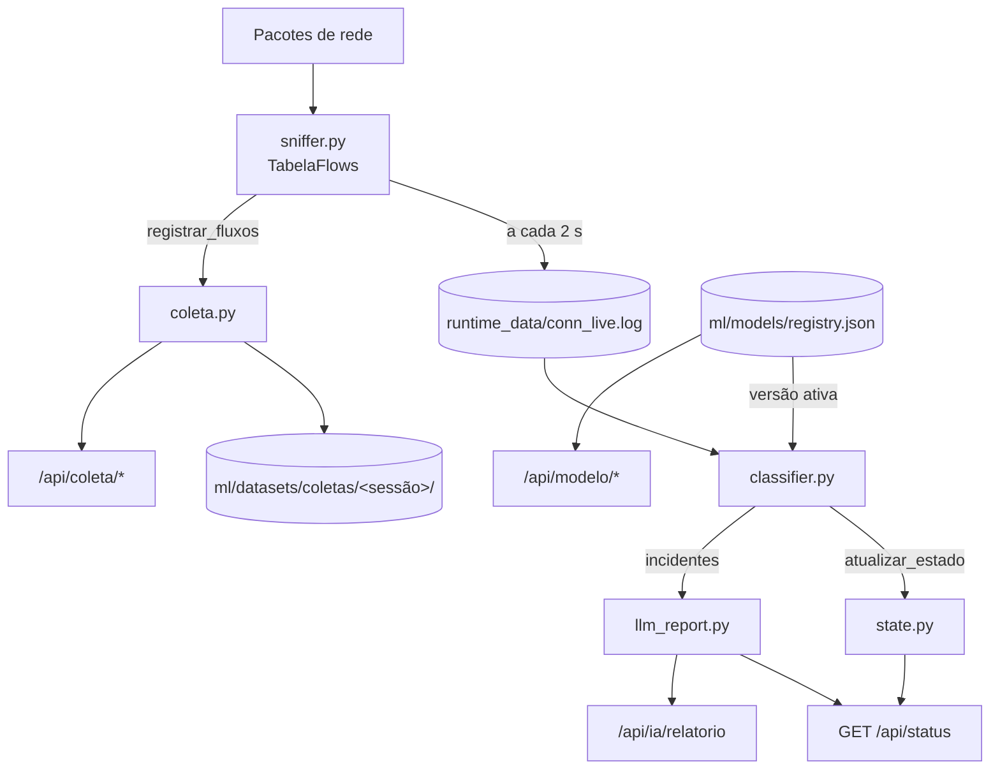
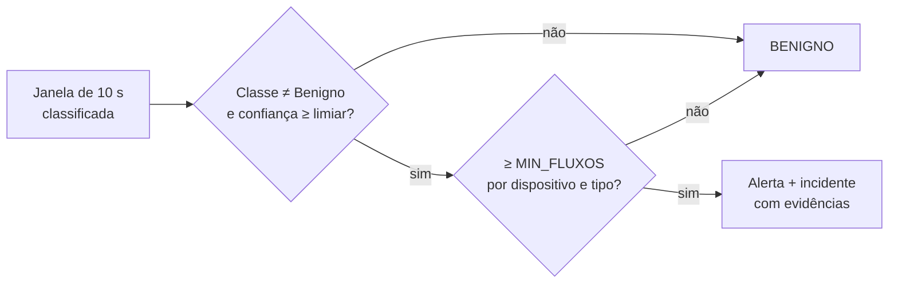
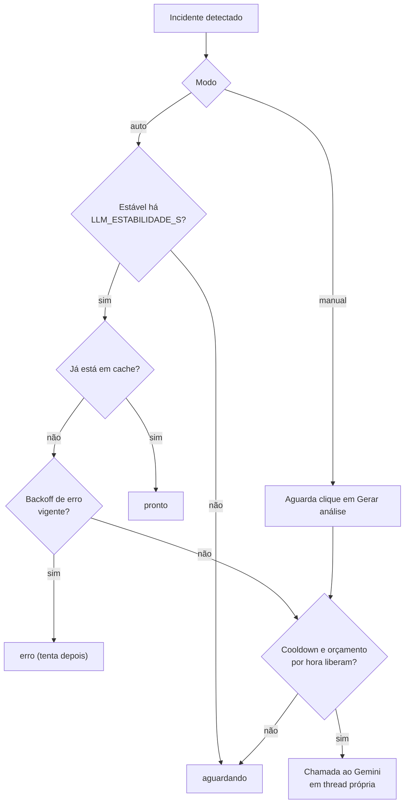
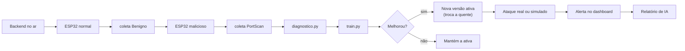

# Backend

API em FastAPI que reúne quatro responsabilidades numa só aplicação:

1. **Capturar** pacotes e montar flows no formato do `conn.log` do Zeek.
2. **Classificar** o tráfego em janelas de 10 s com o modelo XGBoost ativo.
3. **Gerar relatórios** de incidente com IA generativa (Gemini).
4. **Servir** o estado ao dashboard e gerenciar coletas rotuladas e versões de modelo.

## Sumário

- [Estrutura de diretórios](#estrutura-de-diretórios)
- [Como os componentes se conectam](#como-os-componentes-se-conectam)
- [Configuração](#configuração)
- [Endpoints da API](#endpoints-da-api)
- [Comandos de CLI](#comandos-de-cli)
- [Roteiro completo de testes](#roteiro-completo-de-testes)
- [Solução de problemas](#solução-de-problemas)

## Estrutura de diretórios

```
backend/
├── app/
│   ├── main.py                 # entrada FastAPI e ciclo de vida das threads
│   ├── config.py               # configuração central (env vars e caminhos)
│   ├── schemas.py              # modelos Pydantic (API e schema do Gemini)
│   ├── routers/
│   │   ├── status.py           # GET /api/health, GET /api/status
│   │   ├── coleta.py           # coleta rotulada de tráfego
│   │   ├── modelo.py           # versões do modelo: listar, ativar, rollback
│   │   └── ia.py               # relatório de IA: consultar e gerar sob demanda
│   └── services/
│       ├── sniffer.py          # captura Scapy → flows estilo Zeek → conn_live.log
│       ├── classifier.py       # janelas, features, inferência e montagem do payload
│       ├── state.py            # estado compartilhado em RAM (thread-safe)
│       ├── coleta.py           # sessões rotuladas gravadas em ml/datasets/coletas/
│       └── llm_report.py       # relatório de incidente com Gemini e proteções
├── script/
│   └── simular_incidente.py    # injeta um PortScan sintético no conn_live.log
└── runtime_data/               # conn_live.log (e status_debug.json se habilitado)
```

### O que cada arquivo faz

| Arquivo | Função |
|---|---|
| `app/main.py` | Cria a aplicação, registra os routers, libera CORS e, no `lifespan`, sobe o sniffer e o classificador em threads de fundo. Ao encerrar, sinaliza parada e fecha o executor da IA. |
| `app/config.py` | Único lugar com caminhos, limiares e flags. Tudo pode ser sobrescrito por variável de ambiente ou pelo `.env` da raiz. Cria as pastas de runtime na importação. |
| `app/schemas.py` | `StatusResponse`, `DispositivoAtacante` e o schema `RelatorioIA` (severidade, resumo, diagnóstico, ações, ressalvas), que também é usado como `response_schema` do Gemini. |
| `services/sniffer.py` | Mantém a tabela de flows. Reproduz a máquina de estados do Zeek (`S0`, `S1`, `SF`, `REJ`, `RSTO`, `RSTR`, `RSTOS0`, `RSTRH`, `SH`, `SHR`, `OTH`), conta bytes de payload pelo espaço de sequência, aplica timeouts por estado e escreve 22 colunas por linha. |
| `services/classifier.py` | A cada 2 s lê o final do `conn_live.log`, calcula as features com `ml/features.py`, classifica só janelas já fechadas e aplica os filtros de alerta. Recarrega o modelo quando o registro muda. |
| `services/state.py` | Dicionário protegido por lock com o último estado publicado. O classificador escreve, as rotas leem. |
| `services/coleta.py` | Controla uma sessão de coleta por vez. Grava `conn.log` e `meta.json` em `ml/datasets/coletas/<sessão>/`, filtrando pelo IP do dispositivo quando informado. |
| `services/llm_report.py` | Decide se e quando chamar o Gemini. Mantém cache, backoff, cooldown e orçamento por hora, sanitiza a telemetria e executa a chamada numa thread dedicada. |
| `routers/*.py` | Camada HTTP fina sobre os serviços. |
| `script/simular_incidente.py` | Gera flows sintéticos de varredura de portas para testar o relatório sem hardware. |

## Como os componentes se conectam



### Filtros antes de um alerta



### Quando a IA é chamada



## Configuração

Tudo é lido de variáveis de ambiente ou do `.env` na raiz do projeto (veja `.env.example`).

### Captura e classificação

| Variável | Padrão | Descrição |
|---|---|---|
| `IOT_IDS_SUBNET_PREFIX` | `192.168.137.` | Prefixo da sub-rede monitorada. Pacotes fora dele são ignorados. |
| `IOT_IDS_SNIFFER_IFACE` | vazio | Nome da interface. Se vazio, usa o IP abaixo. |
| `IOT_IDS_SNIFFER_IFACE_IP` | `192.168.137.1` | IP do host na interface do hotspot, usado para localizar a interface. |
| `IOT_IDS_ENABLE_SNIFFER` | `true` | `false` desativa a captura (útil com `simular_incidente`). |
| `IOT_IDS_IGNORAR_MULTICAST` | `false` | Ignora broadcast e multicast. Se ligar, retreine com a mesma regra. |
| `IOT_IDS_TIMEOUT_TCP_TENTATIVA` | `5.0` | SYN sem resposta (s). |
| `IOT_IDS_TIMEOUT_TCP_FECHADO` | `2.0` | Após FIN/FIN ou RST (s). |
| `IOT_IDS_TIMEOUT_TCP_ATIVO` | `30.0` | Conexão aberta ociosa (s). O Zeek usa 300. |
| `IOT_IDS_TIMEOUT_UDP_ICMP` | `10.0` | UDP e ICMP (s). O Zeek usa 60. |
| `IOT_IDS_ATRASO_JANELA_S` | `12.0` | Atraso após o fechamento da janela de 10 s, para os flows serem gravados. |
| `IOT_IDS_JANELA_HISTORICO_S` | `300.0` | Quanto tempo de histórico o classificador considera. |
| `IOT_IDS_REPLAY` | `false` | `true` desliga os filtros de tempo para reanalisar um log antigo. |
| `IOT_IDS_CONFIANCA_MINIMA` | `75.0` | Confiança mínima (%) para considerar um fluxo malicioso. |
| `IOT_IDS_MIN_FLUXOS_ALERTA` | `3` | Mínimo de fluxos por (dispositivo, tipo) para virar alerta. |
| `IOT_IDS_MODEL_PATH` | vazio | Força um arquivo de modelo específico e ignora o registro. |
| `IOT_IDS_CONN_LOG_PATH` | `backend/runtime_data/conn_live.log` | Destino do log ao vivo. |
| `IOT_IDS_COLETAS_DIR` | `ml/datasets/coletas` | Pasta das sessões de coleta. |
| `IOT_IDS_WRITE_DEBUG_JSON` | `false` | Grava o estado em `status_debug.json` a cada ciclo. |

### IA generativa

| Variável | Padrão | Descrição |
|---|---|---|
| `GEMINI_API_KEY` | vazio | Chave do Google AI Studio. Sem ela, o relatório é estático. |
| `GEMINI_MODEL` | `gemini-3.5-flash-lite` | Modelo usado. Troque aqui quando ele for aposentado. |
| `IOT_IDS_LLM_HABILITADO` | `true` | Liga ou desliga a camada de IA. |
| `IOT_IDS_LLM_MODO` | `auto` | `auto` chama sozinho; `manual` só pelo botão. |
| `IOT_IDS_LLM_ESTABILIDADE_S` | `6` | Tempo que o incidente precisa persistir antes da 1ª chamada. |
| `IOT_IDS_LLM_COOLDOWN_S` | `30` | Intervalo mínimo entre chamadas automáticas. |
| `IOT_IDS_LLM_MANUAL_MIN_S` | `15` | Intervalo mínimo do botão, por incidente. |
| `IOT_IDS_LLM_CACHE_TTL_S` | `900` | Validade do relatório por assinatura de incidente. |
| `IOT_IDS_LLM_MAX_CHAMADAS_HORA` | `20` | Orçamento rígido em janela deslizante de 1 h. |
| `IOT_IDS_LLM_MAX_INCIDENTES` | `3` | Incidentes agrupados num único relatório. |
| `IOT_IDS_LLM_TIMEOUT_S` | `25` | Timeout da chamada. |
| `IOT_IDS_LLM_BACKOFF_ERRO_S` | `60` | Espera após erro genérico. |
| `IOT_IDS_LLM_BACKOFF_429_S` | `180` | Espera após limite de cota (HTTP 429). |

## Endpoints da API

A documentação interativa (Swagger) fica em `http://localhost:8000/docs`.

| Método | Rota | Descrição |
|---|---|---|
| GET | `/` | Informações básicas do serviço. |
| GET | `/api/health` | Verificação de vida. |
| GET | `/api/status` | Estado completo: status da rede, totais, distribuição, dispositivos em observação, feed e relatório de IA. É o que o dashboard consome. |
| POST | `/api/coleta/iniciar` | Inicia uma sessão rotulada. Corpo: `rotulo`, `ip_dispositivo` (obrigatório para ataques), `descricao`. |
| POST | `/api/coleta/parar` | Encerra a sessão e grava os flows ainda abertos. |
| GET | `/api/coleta/status` | Estado da sessão atual. |
| GET | `/api/coleta/sessoes` | Lista as sessões gravadas (conteúdo dos `meta.json`). |
| GET | `/api/modelo/versoes` | Versão ativa, versão em uso, histórico e métricas resumidas. |
| POST | `/api/modelo/ativar` | Ativa uma versão (`{"versao": "v2"}`). Se não carregar, o registro é restaurado. |
| POST | `/api/modelo/rollback` | Volta para a versão anterior do histórico. |
| POST | `/api/modelo/recarregar` | Força recarregar o modelo ativo. |
| GET | `/api/ia/relatorio` | Estado atual do relatório de IA. |
| POST | `/api/ia/relatorio/gerar` | Dispara a geração sob demanda. Responde `202`, `409` ou `429` (com `Retry-After`). |

Rótulos aceitos na coleta: `Benigno`, `PortScan`, `DDoS`, `Ataque_Generico`, `C&C`, `Botnet_Okiru` (sem diferenciar maiúsculas).

## Comandos de CLI

### 1. Subir o backend (`uvicorn`)

Execute dentro de `backend/`, num terminal **como Administrador** (necessário para o Scapy capturar pacotes).

```powershell
python -m uvicorn app.main:app --host 0.0.0.0 --port 8000
```

| Parâmetro | Função |
|---|---|
| `app.main:app` | Módulo e objeto FastAPI. |
| `--host 0.0.0.0` | Aceita conexões da rede (o dashboard pode estar em outra máquina). Use `127.0.0.1` para restringir. |
| `--port 8000` | Porta da API. O frontend espera 8000 por padrão. |
| `--reload` | Opcional, só para desenvolvimento. Reinicia a cada mudança e também reinicia as threads do sniffer. |

### 2. Simulador de incidente (`script/simular_incidente.py`)

Injeta flows de PortScan sintéticos no `conn_live.log`, sem ESP32.

```powershell
python -m script.simular_incidente [--ip IP] [--fluxos N]
```

| Flag | Padrão | Função |
|---|---|---|
| `--ip` | `192.168.137.99` (prefixo da sub-rede + `99`) | IP fictício do dispositivo atacante. |
| `--fluxos` | `150` | Quantidade de flows gerados. |

Os flows são espalhados entre 60 s e 30 s atrás, em janelas já fechadas, e metade vai para `10.77.0.x` e metade para o host. O incidente fica visível por cerca de 4 minutos (janela de histórico do classificador).

### 3. Cliente de coleta (`ml/coleta.py`)

Fala com o backend em execução. Executado da raiz do projeto.

```powershell
python ml/coleta.py [--api URL] <comando> [opções]
```

| Comando | Opções | Função |
|---|---|---|
| `iniciar` | `--rotulo` (obrigatório), `--ip`, `--descricao` | Abre uma sessão. Para rótulos de ataque, `--ip` é obrigatório para que o tráfego de outras máquinas não seja rotulado como ataque. |
| `parar` | — | Fecha a sessão e informa quantos fluxos foram gravados. |
| `status` | — | Mostra a sessão ativa, fluxos gravados e duração. |
| `sessoes` | — | Lista todas as sessões já gravadas. |

`--api` (padrão `http://localhost:8000`) aponta para outro host do backend.

### 4. Comandos de modelo

O treino, o registro de versões e o diagnóstico ficam em `ml/`. O backend reage às mudanças do registro automaticamente.

| Comando | Resumo |
|---|---|
| `python ml/train.py [flags]` | Treina e salva uma nova versão (`--ativar`, `--ativar-se-melhor`, `--peso-coleta`...). |
| `python ml/registry.py listar` | Lista versões e mostra qual está ativa. |
| `python ml/registry.py ativar vN` | Ativa uma versão (o backend recarrega em ~2 s). |
| `python ml/registry.py rollback` | Volta para a versão anterior. |
| `python ml/diagnostico.py ...` | Compara distribuições de features entre origens. |

Todas as flags estão em [`ml/README.md`](../ml/README.md).

### 5. Atalhos com `curl`

```powershell
curl http://localhost:8000/api/health
curl http://localhost:8000/api/status
curl http://localhost:8000/api/modelo/versoes
curl -X POST http://localhost:8000/api/ia/relatorio/gerar
curl -X POST http://localhost:8000/api/modelo/rollback
```

## Roteiro completo de testes

Este roteiro percorre o fluxo natural do projeto, da coleta de dados ao relatório de IA. Os valores de saída são exemplos do que aparece no meu ambiente (hotspot em `192.168.137.1`).

### Passo 0 — Preparar o ambiente

```powershell
# raiz do projeto
.\venv\Scripts\Activate.ps1
pip install -r requirements.txt
copy .env.example .env
notepad .env          # preencha GEMINI_API_KEY (opcional)
```

Ligue o **Hotspot Móvel** do Windows. O host passa a ter o IP `192.168.137.1`.

### Passo 1 — Subir o backend

Terminal PowerShell **como Administrador**:

```powershell
cd backend
python -m uvicorn app.main:app --host 0.0.0.0 --port 8000
```

No console, os logs de inicialização devem ser parecidos com estes:

```
[STARTUP] Inicializando componentes do IoT-IDS...
[LLM] Ativa | modelo=gemini-3.5-flash-lite | modo=auto | cooldown=30s | máx=20/h | cache=900s
[SNIFFER] Capturando em: IP 192.168.137.1 -> <nome da interface> | filtro de sub-rede: 192.168.137.*
[CLASSIFIER] Modelo carregado: v2
```

Se não existir modelo ainda, aparece o aviso `Nenhum modelo disponível` e o backend tenta de novo a cada 10 s. Você pode treinar o primeiro modelo com o backend já no ar.

Confirme que está respondendo:

```powershell
curl http://localhost:8000/api/health
# {"status":"ok"}
```

### Passo 2 — Gerar tráfego normal com o ESP32

Num segundo terminal, suba o servidor que o ESP32 vai acessar:

```powershell
python -m http.server 8500
```

Grave o firmware em modo normal (`MODO_ATAQUE = 0`, veja [`firmware/README.md`](../firmware/README.md)). No monitor serial aparece:

```
=== MODO: NORMAL (rotule Benigno) ===
[WIFI] Conectado! IP do ESP32: 192.168.137.50  <-- use este IP na coleta
```

Anote o IP, que será usado nas coletas. Nos logs do backend o sniffer começa a mostrar o aumento de `aceitos`:

```
[SNIFFER] stats={'vistos': 412, 'ignorados_proto': 0, 'ignorados_subnet': 6, 'aceitos': 406} flows_ativos=2
```

### Passo 3 — Coletar uma sessão Benigno

Terminal na raiz do projeto, com o venv ativo:

```powershell
python ml/coleta.py iniciar --rotulo Benigno --ip 192.168.137.50 --descricao "ESP32 normal, sessão 1"
```

```json
{
  "ativa": true,
  "nome": "20261120_101530_Benigno_192-168-137-50",
  "rotulo": "Benigno",
  "ip_dispositivo": "192.168.137.50",
  "n_fluxos": 0,
  "segundos": 0
}
```

Deixe correr por uns 5 minutos e acompanhe:

```powershell
python ml/coleta.py status
```

```json
{
  "ativa": true,
  "nome": "20261120_101530_Benigno_192-168-137-50",
  "rotulo": "Benigno",
  "ip_dispositivo": "192.168.137.50",
  "n_fluxos": 71,
  "segundos": 298
}
```

Encerre:

```powershell
python ml/coleta.py parar
```

```json
{
  "nome": "20261120_101530_Benigno_192-168-137-50",
  "rotulo": "Benigno",
  "ip_dispositivo": "192.168.137.50",
  "n_fluxos": 74,
  "pasta": "C:\\pyprojects\\iot-ids\\ml\\datasets\\coletas\\20261120_101530_Benigno_192-168-137-50"
}
```

Se `n_fluxos` vier `0`, a resposta traz um `aviso` com as causas prováveis (IP errado, sniffer sem capturar ou ESP32 sem gerar tráfego).

### Passo 4 — Coletar sessões de PortScan

Regrave o firmware com `MODO_ATAQUE = 1` (ou aperte o botão BOOT no ESP32-C3). O serial mostra o sorteio do ataque:

```
[ATAQUE SORTEADO] sub-tipo=2 | velocidade=1 | porta_fixa=3389
=== MODO: MALICIOSO (rotule PortScan) ===
```

Registre a sessão incluindo o sorteio na descrição, para ficar rastreável depois:

```powershell
python ml/coleta.py iniciar --rotulo PortScan --ip 192.168.137.50 --descricao "sub2 vel1 porta3389"
# ... aguarde alguns minutos ...
python ml/coleta.py parar
```

Repita para outras combinações de sub-tipo e velocidade. Para o treino ter um teste confiável, o ideal são **3 ou mais sessões por classe**.

Confira tudo o que já foi coletado:

```powershell
python ml/coleta.py sessoes
```

### Passo 5 — Verificar a qualidade dos dados (opcional)

```powershell
python ml/diagnostico.py --sessoes
```

Compara a mediana e o p90 das features de janela por rótulo, a proporção de `conn_state`, de `service` e de fluxos com `orig_bytes == 0`. Se o Benigno do ESP32 estiver muito diferente do Benigno do IoT-23, o modelo tende a ficar inseguro (confiança perto de 50%).

### Passo 6 — Treinar uma nova versão

```powershell
python ml/train.py --nota "retreino com sessões do ESP32" --ativar-se-melhor
```

No fim do treino:

```
[SUCESSO] Modelo salvo como v3  (ml/models/model_v3.pkl + .json). Classes: [...]
[INFO] Critério (F1-macro >= ativa, no mesmo teste): ATENDIDO
[INFO] v3 ATIVADA (backend recarrega em ~2 s). Reverter: python ml/registry.py rollback
```

Se o critério não for atendido, a versão ativa é mantida e a nova fica salva sem ser usada.

### Passo 7 — Confirmar a troca a quente

Nos logs do backend, em até 2 s:

```
[CLASSIFIER] Modelo carregado: v3
```

```powershell
curl http://localhost:8000/api/modelo/versoes
```

O campo `ativa` e o campo `em_uso` devem apontar para a mesma versão. Se o modelo novo falhar ao carregar (por exemplo, incompatibilidade de scikit-learn), o backend mantém o anterior em uso e mostra o motivo em `erro_modelo`.

### Passo 8 — Testar o fluxo de alerta de ponta a ponta

**Opção A: com o ESP32.** Mantenha o ESP32 em modo malicioso e abra o dashboard. Em poucos segundos o status muda para *Anomalia*, o dispositivo aparece em *Dispositivos em observação* e um toast de alerta é exibido.

**Opção B: sem hardware.** Injete um incidente sintético:

```powershell
cd backend
python -m script.simular_incidente --ip 192.168.137.99 --fluxos 150
```

```
150 flows de varredura injetados em C:\...\backend\runtime_data\conn_live.log (origem 192.168.137.99).
```

Em até ~15 s o classificador analisa as janelas fechadas:

```powershell
curl http://localhost:8000/api/status
```

Trecho esperado da resposta:

```json
{
  "status_rede": "SOB ATAQUE",
  "modelo_versao": "v3",
  "dispositivos_atacantes": [
    {
      "ip_dispositivo": "192.168.137.99",
      "tipo_ataque": "PortScan",
      "fluxos_maliciosos": 150,
      "confianca_ia_pct": 97.4
    }
  ]
}
```

### Passo 9 — Acompanhar o relatório de IA

No modo `auto`, o relatório só é gerado depois de 6 s de estabilidade e respeitando o cooldown. O estado passa por:

```
ocioso → aguardando → gerando → pronto
```

```powershell
curl http://localhost:8000/api/ia/relatorio
```

No console do backend:

```
[LLM] Relatório gerado em 3.8s | incidente=192.168.137.99:PortScan
```

Para forçar uma nova análise (ignora o cache, mas respeita o intervalo mínimo e o orçamento por hora):

```powershell
curl -X POST http://localhost:8000/api/ia/relatorio/gerar
```

| Resposta | Significado |
|---|---|
| `202` | Geração iniciada. |
| `409` | Não há incidente ativo, a IA está desativada ou já há uma geração em andamento. |
| `429` | Intervalo mínimo ou orçamento por hora. O cabeçalho `Retry-After` indica quanto esperar. |

Para testar o modo manual, defina `IOT_IDS_LLM_MODO=manual` no `.env`, reinicie e use o botão *Gerar análise* do dashboard.

### Passo 10 — Reverter caso a versão nova se comporte pior

```powershell
python ml/registry.py rollback
# Rollback concluído. Versão ativa: v2 (o backend recarrega em ~2 s)
```

Ou pela API:

```powershell
curl -X POST http://localhost:8000/api/modelo/rollback
```

### Resumo do fluxo



## Solução de problemas

| Sintoma | Causa provável e o que fazer |
|---|---|
| `Permissão negada. Rode o backend como Administrador.` | Abra o terminal como Administrador. |
| `Aguardando interface...` | O hotspot não está ligado ou `IOT_IDS_SNIFFER_IFACE_IP` não corresponde ao IP da interface. |
| `AVISO: nenhum pacote IP visto` | Interface errada, hotspot sem clientes ou Npcap ausente. |
| `AVISO: pacotes vistos, mas fora de 192.168.137.*` | Ajuste `IOT_IDS_SUBNET_PREFIX`. |
| `erro_modelo` no `/api/status` | Versões de scikit-learn ou xgboost diferentes entre treino e backend. Use as mesmas do `requirements.txt`. |
| Relatório sempre estático | `GEMINI_API_KEY` ausente, `google-genai` não instalado ou IA desativada. A mensagem exata aparece no campo `mensagem` do relatório. |
| `429` no gerar | Aguarde o tempo do `Retry-After` ou veja `chamadas_restantes_hora`. |
| Coleta com `0 fluxos` | IP do dispositivo errado ou ESP32 sem tráfego. Apague a pasta da sessão se não servir. |