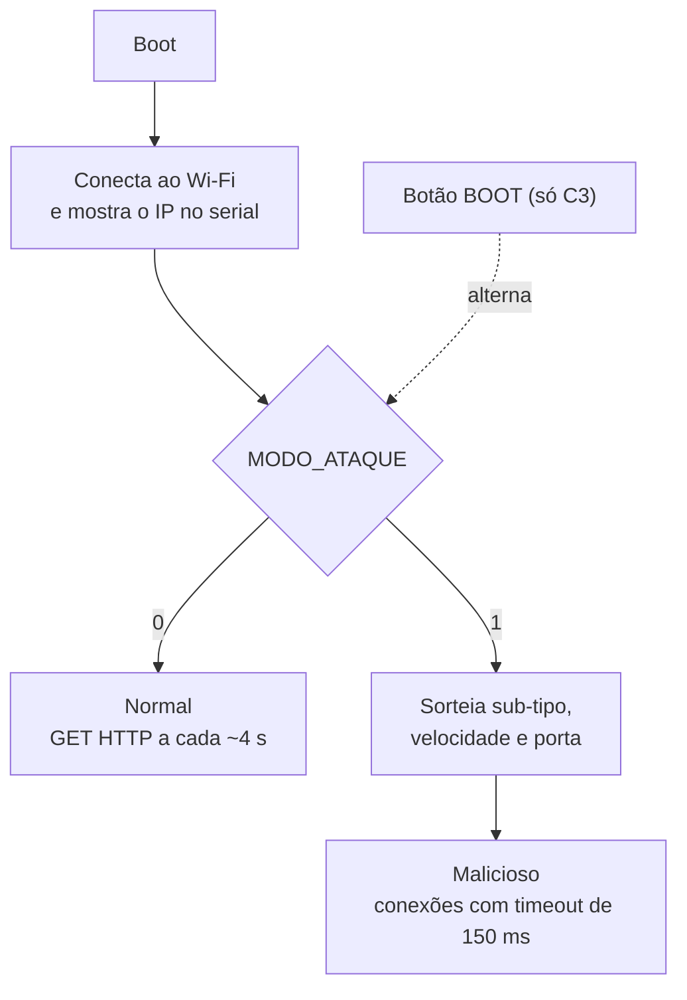

# Firmware

Firmwares de teste para ESP32 que geram **tráfego real** na rede do hotspot, usados para coletar sessões rotuladas e para demonstrar o sistema. Eles não fazem parte da detecção em si: servem para alimentar o sniffer com tráfego benigno e com varreduras de portas conhecidas.

> O modelo não deve depender deste firmware. Ele só gera dados variados. Para um modelo robusto, colete também tráfego de outras fontes (celular, notebook, `nmap`).

## Projetos

| Pasta | Placa | Diferenciais |
|---|---|---|
| `esp32_test_firmware/` | ESP32-S3 (`esp32-s3-devkitm-1` e `waveshare-esp32-s3-zero`) | Versão simples; o modo é escolhido em tempo de compilação. |
| `esp32-c3_test_firmware/` | ESP32-C3 (`esp32-c3-devkitm-1`) | OLED 0.42" com rosto animado, botão BOOT para alternar o modo em tempo de execução, tarefas FreeRTOS separadas para tela e rede. |

## Estrutura

```
firmware/
├── esp32_test_firmware/
│   ├── platformio.ini          # ambientes S3 (devkit e Waveshare S3-Zero)
│   └── src/main.cpp            # lógica de tráfego normal e malicioso
└── esp32-c3_test_firmware/
    ├── platformio.ini          # ambiente C3 + biblioteca U8g2
    └── src/main.cpp            # tráfego + animação OLED + botão de modo
```

As pastas `lib/`, `include/` e `test/` são o esqueleto padrão do PlatformIO e estão vazias de código próprio.

### Arquivos relevantes

| Arquivo | Função |
|---|---|
| `esp32_test_firmware/platformio.ini` | Define dois ambientes: `esp32-s3-devkitm-1` e `waveshare-esp32-s3-zero` (flash de 4 MB, partição `default.csv`, USB CDC ativado). |
| `esp32_test_firmware/src/main.cpp` | Conecta ao Wi-Fi e executa o modo normal ou o malicioso, definido em tempo de compilação. |
| `esp32-c3_test_firmware/platformio.ini` | Ambiente `esp32-c3-devkitm-1` com USB CDC e a dependência `olikraus/U8g2`. |
| `esp32-c3_test_firmware/src/main.cpp` | Duas tarefas FreeRTOS: `DisplayTask` (animação e botão) e `NetworkTask` (tráfego). Estado compartilhado protegido por `portMUX`. |

## Modos de operação

| Modo | Rótulo na coleta | Comportamento |
|---|---|---|
| Normal (`MODO_ATAQUE = 0`) | `Benigno` | `GET /` HTTP para `192.168.137.1:8500` a cada ~4 s, com jitter de ±0,5 s. |
| Malicioso (`MODO_ATAQUE = 1`) | `PortScan` | Tentativas de conexão TCP com timeout de 150 ms, com parâmetros sorteados. |

### Parâmetros sorteados no modo malicioso

No S3 o sorteio acontece a cada boot. No C3 acontece a cada vez que se entra no modo malicioso (inclusive pelo botão).

| Parâmetro | Valores |
|---|---|
| **Sub-tipo** | `0` misto: portas comuns ou aleatórias, alvos variados (host e `10.77.0.x`) · `1` brute-force: uma porta fixa no gateway · `2` horizontal: mesma porta, muitos IPs `10.77.0.2–250` (padrão do IoT-23) |
| **Velocidade** | `0` rápido: 5 a 50 ms entre tentativas · `1` médio: 50 a 400 ms · `2` lento: 0,3 a 2 s |
| **Porta fixa** | Sorteada de `21, 22, 23, 25, 53, 80, 110, 143, 443, 445, 1883, 3306, 3389, 8080, 8883` |

O monitor serial imprime o sorteio. Copie-o para a descrição da coleta, assim cada sessão fica rastreável:

```
[ATAQUE SORTEADO] sub-tipo=1 | velocidade=0 | porta_fixa=25
=== MODO: MALICIOSO (rotule PortScan) ===
```



## Configuração

Edite no topo do `src/main.cpp` de cada projeto:

| Constante | Valor atual | Descrição |
|---|---|---|
| `WIFI_SSID` / `WIFI_SENHA` | definidos no código | Credenciais do hotspot. Troque pelas suas e evite publicar a senha real. |
| `SERVIDOR_NORMAL` | `192.168.137.1` | Host contatado no modo normal. |
| `PORTA_SERVIDOR_NORMAL` | `8500` | Porta do servidor do modo normal. |
| `GATEWAY_HOTSPOT` | `192.168.137.1` | Alvo do brute-force e de parte dos scans mistos. |
| `PORTAS_COMUNS[]` | lista de 15 portas | Portas usadas nos scans. |
| `MODO_ATAQUE` | `0` | Modo inicial (veja abaixo). |

O IP e a sub-rede precisam bater com `IOT_IDS_SUBNET_PREFIX` e `IOT_IDS_SNIFFER_IFACE_IP` do backend.

### Escolhendo o modo

- **ESP32-S3:** `MODO_ATAQUE` é um `#define` fixo no `main.cpp`. Altere para `0` ou `1` e regrave.
- **ESP32-C3:** o `#define` só vale se não vier de fora, então também aceita `-D MODO_ATAQUE=1` em `build_flags`. Em execução, o **botão BOOT (GPIO 9)** alterna entre os modos, com debounce de 180 ms, e a cada troca para o modo malicioso novos parâmetros são sorteados.

## ESP32-C3: tela OLED

| Item | Valor |
|---|---|
| Display | OLED SSD1306 0.42" (72×40), U8g2 por I2C por hardware |
| Pinos | SCL = GPIO 6 · SDA = GPIO 5 |
| Botão | BOOT = GPIO 9 (`INPUT_PULLUP`) |

O rosto animado indica o modo em que o dispositivo está:

| Modo | Rosto |
|---|---|
| Normal | Feliz: olhos arredondados, sorriso e sobrancelhas arqueadas |
| Malicioso | Zangado: sobrancelhas inclinadas e tremor aleatório |

A animação percorre as fases `RAMP_UP → PEAK_ACTION → HOLD → RAMP_DOWN → PAUSE` e é reiniciada a cada troca de modo.

## Como gravar e usar

Com a extensão PlatformIO no VS Code (ou o CLI `pio`), dentro da pasta do projeto:

```powershell
pio run -e esp32-c3-devkitm-1 -t upload     # exemplo para o C3
pio device monitor                          # serial a 115200
```

Para o S3, use `-e esp32-s3-devkitm-1` ou `-e waveshare-esp32-s3-zero`.

1. No notebook, ligue o hotspot e suba o servidor do modo normal:
   ```powershell
   python -m http.server 8500
   ```
2. Grave o firmware e abra o monitor serial. Anote o IP exibido:
   ```
   [WIFI] Conectado! IP do ESP32: 192.168.137.50  <-- use este IP na coleta
   ```
3. Inicie a coleta informando esse IP:
   ```powershell
   python ml/coleta.py iniciar --rotulo Benigno --ip 192.168.137.50 --descricao "ESP32 normal"
   ```
4. Repita no modo malicioso com `--rotulo PortScan`.

O roteiro completo, da coleta ao treino e ao alerta, está em [`backend/README.md`](../backend/README.md#roteiro-completo-de-testes).

## Observações

- No modo normal, se o servidor `http.server` não estiver rodando, o serial mostra `[NORMAL] Falha de conexão`, e o tráfego ficará menos representativo.
- O tráfego malicioso é intencionalmente simples (varredura TCP). Se quiser cobrir mais comportamentos, o caminho natural é adicionar novos sub-tipos em `executarPassoMalicioso()` e novos rótulos na coleta.
- Use esses firmwares apenas na sua própria rede de laboratório.