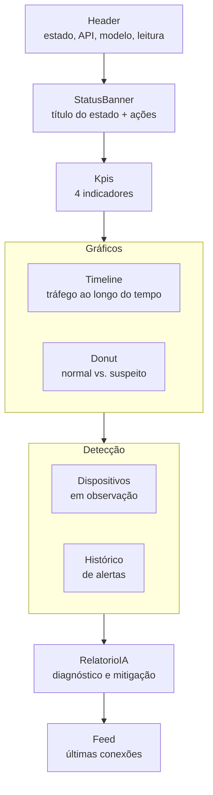
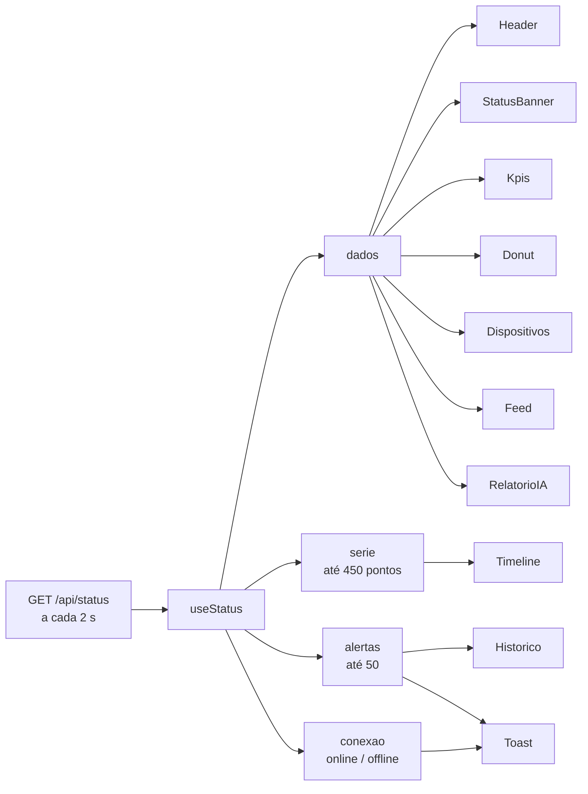

# Frontend

Dashboard em tempo real do CyberSentinel-IoT. É uma SPA em React que consulta `GET /api/status` a cada 2 s e apresenta o estado da rede, os dispositivos suspeitos, o histórico de alertas e o relatório de incidente gerado por IA.

## Stack

| Tecnologia | Versão | Uso |
|---|---|---|
| React | 19 | Interface |
| Vite | 8 | Dev server e build |
| Tailwind CSS | 4 (`@tailwindcss/vite`) | Estilização, com tema escuro por classe `.dark` |
| Recharts | 3 | Gráficos de área e rosca |
| lucide-react | 1.x | Ícones |
| Inter / JetBrains Mono | fontsource | Tipografia |

Requer Node.js `^20.19` ou `>=22.12`.

## Como rodar

```powershell
npm install
npm run dev        # http://localhost:5173 (exposto na rede)
```

| Script | Função |
|---|---|
| `npm run dev` | Servidor de desenvolvimento em `0.0.0.0:5173`. |
| `npm run build` | Gera o build de produção em `dist/`. |
| `npm run preview` | Serve o build em `0.0.0.0:5173`. |
| `npm run lint` | ESLint (regras do React Hooks e React Refresh). |

### Variável de ambiente

| Variável | Padrão | Descrição |
|---|---|---|
| `VITE_API_BASE_URL` | `http://localhost:8000` | URL do backend. Copie `.env.example` para `.env` se ele estiver em outro host. Reinicie o `npm run dev` depois de alterar. |

## Estrutura

```
frontend/
├── index.html                  # aplica o tema salvo antes do React montar
├── vite.config.js
├── eslint.config.js
├── .env.example
└── src/
    ├── main.jsx                # monta ThemeProvider + ToastProvider + App
    ├── App.jsx                 # composição da página e efeitos de alerta/conexão
    ├── index.css               # Tailwind, tema escuro, animações e utilitários
    ├── estado.js               # estado global do sistema e tons semânticos
    ├── format.js               # fmtPct e fmtInt (pt-BR)
    ├── hooks/
    │   └── useStatus.js        # polling da API, série temporal e histórico de alertas
    ├── theme/
    │   ├── ThemeContext.jsx    # alternância claro/escuro com persistência
    │   ├── tipos.js            # cores e badges por classe de tráfego; paleta dos gráficos
    │   └── ui.js               # classes dos botões primário e secundário
    └── components/
        ├── Header.jsx
        ├── StatusBanner.jsx
        ├── Kpis.jsx
        ├── Charts.jsx
        ├── Dispositivos.jsx
        ├── Panels.jsx
        ├── RelatorioIA.jsx
        ├── Card.jsx
        ├── ProgressBar.jsx
        ├── Tag.jsx
        ├── FiltroPaginado.jsx
        └── Toast.jsx
```

## Layout da página



## Fluxo de dados



## Módulos e componentes

### Núcleo

| Arquivo | Papel |
|---|---|
| `App.jsx` | Monta a página, usa `useStatus` e dispara toasts quando surge um alerta novo ou quando a conexão cai ou volta. |
| `hooks/useStatus.js` | Consulta a API a cada 2 s com timeout de 6 s. Considera o backend offline após 3 falhas seguidas. Mantém a série temporal (até 450 pontos, cerca de 15 min), o histórico de alertas (até 50) e a latência. Expõe `recarregar` para o botão de atualização. |
| `estado.js` | `estadoSistema(dados, conexao)` converte `status_rede` e a conexão em título, rótulo, ícone e tom (`ok`, `warn`, `bad`, `idle`). `TONS` reúne as classes Tailwind de cada tom. |
| `format.js` | `fmtPct` (2 casas decimais) e `fmtInt` (separador de milhar pt-BR). |

### Tema

| Arquivo | Papel |
|---|---|
| `theme/ThemeContext.jsx` | Alterna entre claro e escuro, aplica a classe `dark` no `<html>` e persiste a escolha em `localStorage` (`iot-ids-tema`). |
| `theme/tipos.js` | Mapeia cada classe de tráfego (Benigno, PortScan, DDoS, C&C, Botnet_Okiru, Ataque_Generico) para cor hex e classes de badge. Também define a paleta dos gráficos por tema. |
| `theme/ui.js` | Estilos compartilhados dos botões. |

### Componentes de página

| Componente | O que mostra |
|---|---|
| `Header` | Logo, pílula de estado do sistema com menu (Rede, Backend, Classificador, Relatório IA), conexão com a API e latência, versão do modelo XGBoost, modelo generativo ativo e horário da última leitura com botão de atualização. |
| `StatusBanner` | Título e subtítulo do estado atual, botão de alternar tema, atalho *Ver relatório* quando há incidente e aviso quando há `erro_modelo`. |
| `Kpis` | Fluxos analisados, fluxos suspeitos (com confiança média), dispositivos em observação e taxa de tráfego suspeito. |
| `Charts.jsx` → `Timeline` | Gráfico de área de benignos e suspeitos, com seletor de período (1 min, 5 min, tudo). |
| `Charts.jsx` → `Donut` | Distribuição por classe de tráfego, com percentual de benigno no centro e barras por tipo. |
| `Dispositivos` | Lista de origens suspeitas com tipo de ataque, alvo, último alerta, confiança e barra proporcional ao número de fluxos. |
| `Panels.jsx` → `Historico` | Alertas da sessão, com filtro por campo e paginação. |
| `Panels.jsx` → `Feed` | Tabela das últimas conexões classificadas, com protocolo, classificação e barra de confiança. |
| `RelatorioIA` | Severidade, resumo, diagnóstico técnico e ações de mitigação com comandos copiáveis e ressalvas. Traz o botão *Gerar/Regenerar análise* (`POST /api/ia/relatorio/gerar`), estados de espera e erro e o orçamento de chamadas restantes na hora. Sem IA, exibe o resumo estático. |

### Componentes de apoio

| Componente | Papel |
|---|---|
| `Card` | Contêiner padrão com título, subtítulo e ação opcional. |
| `ProgressBar` | Barra de progresso com `role="progressbar"`, aceitando classe Tailwind ou cor hex. |
| `Tag` | Badge colorido por classe de tráfego. |
| `FiltroPaginado` | Hook `useFiltro` e componentes `BarraFiltro` e `Paginacao`. Os campos numéricos filtram por valor mínimo. |
| `Toast` | Provider e hook `useToast` para notificações (até 3 simultâneas, com tons e substituição por chave). |

## Observações

- O gerenciamento de modelos (ativar versão, rollback) e a coleta rotulada não têm tela no dashboard. Eles são feitos pela API e pela CLI, descritas em [`backend/README.md`](../backend/README.md) e [`ml/README.md`](../ml/README.md). O dashboard só exibe a versão do modelo em uso.
- O acesso à área de transferência no `RelatorioIA` tem fallback com `textarea` para funcionar em HTTP na rede local, onde `navigator.clipboard` não está disponível.
- Animações e transições são desativadas para quem usa `prefers-reduced-motion`.