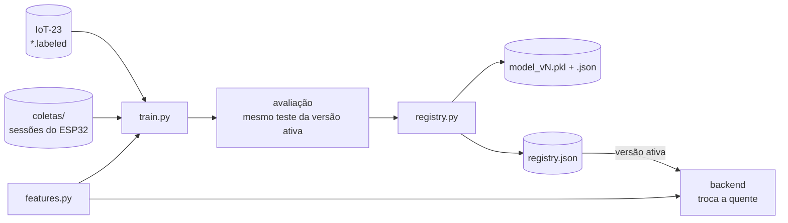

# ML

Tudo o que envolve dados e modelos do CyberSentinel-IoT: engenharia de features, coleta rotulada, treino, versionamento e diagnóstico. O backend importa este pacote diretamente (`from ml import features, registry`), por isso o treino e a inferência usam exatamente o mesmo código.

## Estrutura

```
ml/
├── __init__.py
├── features.py         # fonte única das features (treino e inferência)
├── train.py            # treino, avaliação e registro de nova versão
├── registry.py         # versionamento, ativação e rollback de modelos
├── coleta.py           # cliente de linha de comando da coleta rotulada
├── diagnostico.py      # comparação de distribuições entre origens
├── datasets/
│   ├── *.labeled       # arquivos do IoT-23 (não versionados)
│   └── coletas/        # sessões coletadas do seu ambiente
│       └── <sessão>/
│           ├── conn.log    # flows (22 colunas)
│           └── meta.json   # rótulo, IP, horários, nº de fluxos, "ativa"
└── models/
    ├── registry.json       # versão ativa, histórico e resumo das versões
    ├── model_vN.pkl        # artefato (joblib) — não versionado no Git
    └── model_vN.json       # metadados completos da versão
```

## Visão do pipeline



## `features.py`

É a fonte única da engenharia de features. Antes de unificar, o treino e o classificador divergiam na marcação de conexões `S0`, o que gerava *training-serving skew*. Agora os dois chamam as mesmas funções.

| Item | Descrição |
|---|---|
| `JANELA_S = 10` | Tamanho da janela de agregação, em segundos. |
| `VERSAO_FEATURES = 2` | Versão do conjunto de features, gravada nos metadados do modelo. |
| `CONN_FALHA` | Estados Zeek tratados como tentativa que não virou conversa: `S0`, `REJ`, `RSTO`, `RSTOS0`, `RSTRH`, `SH`. |
| `ler_conn_log()` | Lê o `conn_live.log` ou o `conn.log` de uma coleta (22 colunas, separador TAB). |
| `preparar_janelas()` | Cria `bloco_10s`, `id_janela_unica` e as features `win_*`. No treino, `col_sessao` evita misturar janelas de capturas diferentes. |
| `montar_X()` | Monta a matriz de entrada com o mesmo tratamento de nulos no treino e na inferência. |

### Features usadas pelo modelo

| Tipo | Colunas |
|---|---|
| Categóricas | `proto`, `service`, `conn_state` |
| Do flow | `duration`, `orig_bytes`, `resp_bytes`, `missed_bytes`, `orig_pkts`, `orig_ip_bytes`, `resp_pkts`, `resp_ip_bytes` |
| Da janela de 10 s (por origem) | `win_qtd_conexoes`, `win_ips_destino_unicos`, `win_portas_destino_unicas`, `win_media_orig_bytes`, `win_taxa_s0`, `win_taxa_falha` |

## `train.py`

Treina Random Forest e XGBoost (o backend usa o XGBoost), avalia, compara com a versão ativa e salva uma nova versão. **Nada é sobrescrito**: cada execução gera `model_vN.pkl` e `model_vN.json`.

```powershell
python ml/train.py                                   # IoT-23 + coletas
python ml/train.py --ativar-se-melhor                # só ativa se não piorar
python ml/train.py --fontes coletas                  # só dados do seu ambiente
python ml/train.py --peso-coleta 5 --nota "mais sessões do ESP32"
```

| Flag | Padrão | Descrição |
|---|---|---|
| `--dataset-dir` | `ml/datasets` | Pasta com os `*.labeled` do IoT-23. |
| `--coletas-dir` | `ml/datasets/coletas` | Pasta das sessões coletadas. |
| `--fontes` | `iot23,coletas` | Fontes de dados: `iot23`, `coletas` ou ambas. |
| `--limite-por-classe` | `15000` | Teto de fluxos por (origem, classe), para balancear. |
| `--peso-coleta` | `3.0` | Peso extra das amostras coletadas do seu ambiente. |
| `--max-linhas` | `200000` | Linhas lidas por arquivo do IoT-23. |
| `--limiar` | `75.0` | Limiar de confiança das métricas operacionais. |
| `--seed` | `42` | Semente aleatória. |
| `--ativar` | desligado | Ativa a nova versão ao final. |
| `--ativar-se-melhor` | desligado | Ativa só se o F1-macro for maior ou igual ao da ativa, no mesmo teste. |
| `--nota` | vazio | Comentário gravado nos metadados. |

### Decisões que evitam métricas infladas

- As janelas são calculadas **antes** de qualquer amostragem e separadas por arquivo ou sessão.
- No IoT-23, o split usa `StratifiedGroupKFold` agrupado por janela, então flows da mesma janela nunca ficam um em cada lado.
- Nas coletas, janelas vizinhas são quase idênticas, então sortear janelas aleatórias vazaria informação. Por isso: se a classe tem 2 ou mais sessões, a **sessão mais recente inteira** vai para teste; com 1 sessão só, os **últimos 20% do tempo** vão para teste, com folga de um bloco. O treino avisa quando faltam sessões.
- O novo modelo e o ativo são avaliados **no mesmo conjunto de teste**, o que torna a comparação justa.
- Além de acurácia e F1, o treino reporta métricas operacionais com o filtro de confiança: confiança média por tipo, taxa de falso alarme no benigno e taxa de detecção de ataque.

### Mapeamento de rótulos do IoT-23

| Rótulo original | Classe |
|---|---|
| `Benign` | `Benigno` |
| `PartOfAHorizontalPortScan`, `C&C-PartOfAHorizontalPortScan` | `PortScan` |
| `Attack` | `Ataque_Generico` |
| `C&C`, `C&C-HeartBeat`, `C&C-FileDownload`, `C&C-HeartBeat-FileDownload`, `C&C-Torii`, `C&C-Mirai` | `C&C` |
| `DDoS` | `DDoS` |
| `Okiru` | `Botnet_Okiru` |

## `registry.py`

Controla as versões. O `registry.json` guarda a versão ativa, o histórico de ativações (usado no rollback) e um resumo de cada versão. A escrita é atômica, então o backend nunca lê um JSON pela metade.

```powershell
python ml/registry.py listar
python ml/registry.py info v2
python ml/registry.py ativar v2
python ml/registry.py rollback
python ml/registry.py remover v1
python ml/registry.py comparar v1 v2
```

| Comando | Função |
|---|---|
| `listar` | Tabela com versão, data, F1-macro, acurácia, F1 nas coletas e nota. Marca a ativa com `→`. Também migra o legado `motor_ia_ids_iot.joblib` para `v1`, se existir. |
| `info vN` | Imprime os metadados completos (`model_vN.json`). |
| `ativar vN` | Torna a versão ativa e empilha a anterior no histórico. O backend recarrega em ~2 s. |
| `rollback` | Volta para a versão anterior do histórico que ainda existe em disco. |
| `remover vN` | Apaga a versão. Não remove a ativa. |
| `comparar vA vB` | Mostra as métricas resumidas lado a lado. Atenção: versões diferentes podem ter testes diferentes; para comparação justa use a seção `comparacao_com_ativo` impressa pelo `train.py`. |

### Conteúdo de `model_vN.json`

Métricas (geral, por classe e só das coletas), métricas do Random Forest, comparação com a versão ativa na época do treino, composição dos dados (fontes, tamanhos, sessões usadas), parâmetros do treino, features, classes e versões das bibliotecas. Esse último campo ajuda a diagnosticar incompatibilidades de `scikit-learn` e `xgboost`.

## `coleta.py`

Cliente de linha de comando da coleta rotulada. Ele fala com o backend em execução; a gravação em si acontece no serviço `backend/app/services/coleta.py`.

```powershell
python ml/coleta.py iniciar --rotulo Benigno  --ip 192.168.137.50 --descricao "ESP32 normal"
python ml/coleta.py iniciar --rotulo PortScan --ip 192.168.137.50 --descricao "sub1 vel0 porta80"
python ml/coleta.py status
python ml/coleta.py parar
python ml/coleta.py sessoes
```

| Opção | Descrição |
|---|---|
| `--api` | URL do backend (padrão `http://localhost:8000`). |
| `iniciar --rotulo` | `Benigno`, `PortScan`, `DDoS`, `Ataque_Generico`, `C&C` ou `Botnet_Okiru`. |
| `iniciar --ip` | IP do dispositivo. Obrigatório para rótulos de ataque: só entram flows originados nesse IP. |
| `iniciar --descricao` | Texto livre. Vale anotar o sorteio do firmware (sub-tipo, velocidade, porta). |

### Como excluir uma sessão ruim sem apagá-la

Edite o `meta.json` da sessão e defina `"ativa": false`. O treino a ignora.

## `diagnostico.py`

Compara **distribuições** entre origens, que é a causa raiz do *training-serving skew*. Para cada grupo mostra a mediana e o p90 das features de janela, a proporção de `conn_state` e de `service` e o percentual de fluxos com `orig_bytes == 0`.

```powershell
python ml/diagnostico.py --log backend/runtime_data/conn_live.log
python ml/diagnostico.py --sessoes
python ml/diagnostico.py --iot23 --max-linhas 50000
```

| Flag | Descrição |
|---|---|
| `--log` | Analisa um `conn_live.log`. |
| `--sessoes` | Analisa todas as sessões coletadas, agrupadas por rótulo. |
| `--iot23` | Inclui o IoT-23, agrupado por tipo de tráfego. |
| `--max-linhas` | Linhas lidas por arquivo do IoT-23 (padrão 50000). |

Se o "Benigno do ESP32" estiver muito diferente do "Benigno do IoT-23", o modelo tende a ficar incerto, com confiança próxima de 50%.

## Versões atuais

| Versão | Origem | F1-macro (geral) | Acurácia | Detecção nas coletas | Nota |
|---|---|---|---|---|---|
| `v1` | Importada do modelo legado | n/d | n/d | 35,5% | Sem métricas registradas; o valor de detecção vem da comparação feita no treino da `v2`. |
| `v2` | IoT-23 + 10 sessões coletadas | 0,9807 | 0,9779 | 100% | Primeiro retreino. |

Na `v2`, o falso alarme no benigno foi de 2,81% e a detecção de ataque, de 96,90% (limiar de 75%). O F1-macro de 0,4938 nas coletas aparece baixo porque o teste das coletas só contém Benigno e PortScan, e as demais classes entram com suporte zero na média. A acurácia nessas coletas foi de 98,5%.

## Fluxo recomendado

1. Coletar sessões Benigno e PortScan com o firmware (`coleta.py`).
2. Conferir as distribuições (`diagnostico.py --sessoes`).
3. Treinar (`train.py --ativar-se-melhor`).
4. Se algo ficar estranho em produção, `registry.py rollback`.

A explicação completa de cada passo, com as saídas esperadas, está em [`backend/README.md`](../backend/README.md#roteiro-completo-de-testes).

## Dependências

`numpy`, `pandas`, `scikit-learn`, `xgboost` e `joblib`, todas no `requirements.txt` da raiz. Os modelos foram treinados com Python 3.12, scikit-learn 1.5.2 e xgboost 2.1.4. Use as mesmas versões no ambiente do backend para o `.pkl` carregar sem erro.